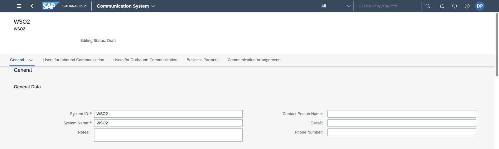
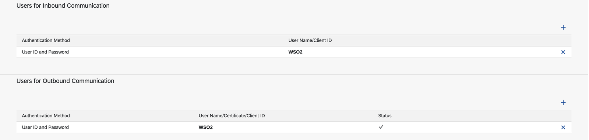
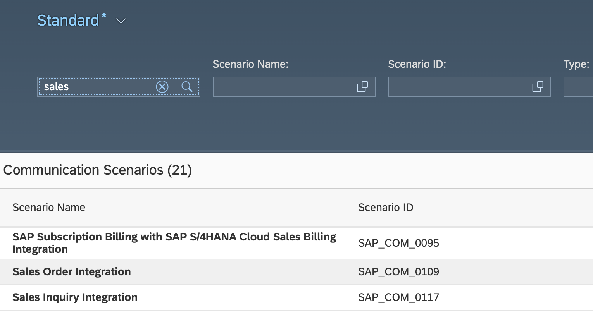
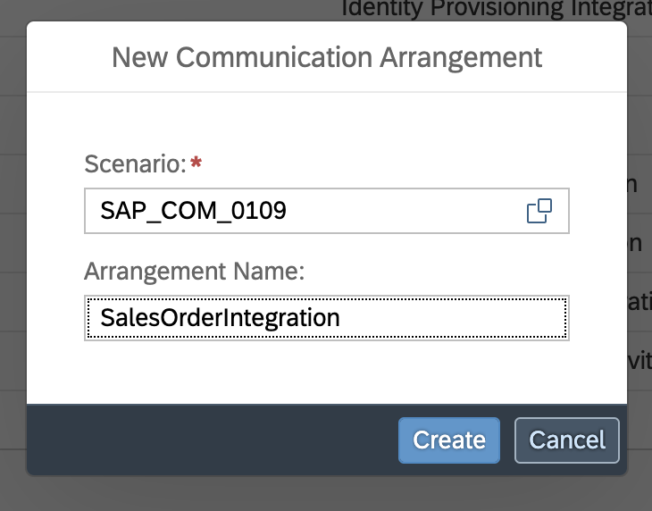
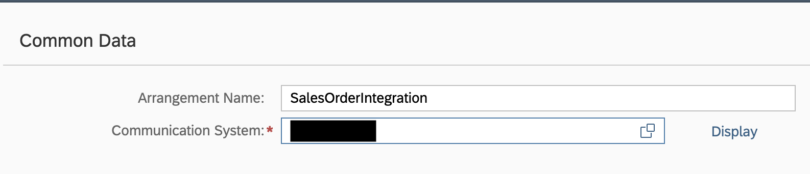

## Overview

[SAP S/4HANA](https://www.sap.com/products/erp/s4hana.html) is a robust enterprise resource planning (ERP) solution,
designed for large-scale enterprises by SAP SE. It covers core business processes such as finance, procurement, sales,
and materials management, including sales and distribution.

The SAP S/4HANA Sales connector provides APIs that enable seamless integration with the [Sales District - Read API v1.0.0](https://api.sap.com/api/API_SALESDISTRICT_SRV/overview). The service contains sales district and sales district text nodes.

### Key Features

- Read sales district master data from SAP S/4HANA
- Access sales district and sales district text nodes
- Seamless integration with the Sales District - Read API v1.0.0
- Support for basic and OAuth 2.0 authentication

## Setup guide

This connector uses **Basic Authentication** with an SAP S/4HANA Cloud communication user. Each S/4HANA API is
exposed through a communication scenario, so the user must be assigned to a communication arrangement for the
**SAP Analytics Cloud for Planning Integration (`SAP_COM_0087`)** scenario before the connector can call it.

All the apps used below are in the **Communication Management** group of the SAP Fiori launchpad.


### Step 1: Create a communication user

1. Sign in to your SAP S/4HANA Cloud system as an administrator.
2. Open the **Maintain Communication Users** app and choose **New**.
3. Enter a user name and a description, set a password, and choose **Create**.

Note the user name and password. These are the credentials the connector uses.

### Step 2: Create a communication system

1. Open the **Communication Systems** app and choose **New**.
2. Enter a system ID and a system name, and choose **Create**.

   

3. Under **General** > **Technical Data**, enter a host name and a **Logical System** (an uppercase ID of up to
   10 characters, for example, `INTEGRATOR`). Some scenarios refuse to activate when the logical system is empty.
4. Under **Users for Inbound Communication**, add the communication user from Step 1 with the
   **User Name and Password** authentication method.

   

5. Choose **Save**.

### Step 3: Create a communication arrangement

1. Open the **Communication Arrangements** app and choose **New**.
2. In the **Scenario** value help, search for **SAP Analytics Cloud for Planning Integration** and select **`SAP_COM_0087`**.
   This is the scenario that exposes `API_SALESDISTRICT_SRV`, the service this connector calls.

   

3. Enter a unique name for the arrangement and choose **Create**.

   

4. Select the communication system from Step 2. The communication user from Step 1 is filled in as the inbound user.
   If the scenario lists outbound services that the integration does not need, clear their **Active** check boxes so
   that no outbound user is required.

   

5. Choose **Save**.

### Step 4: Note the hostname

Open the saved arrangement. The **API-URL** next to **Own SAP Cloud System** shows the hostname
(`<unique id>-api.s4hana.cloud.sap`).


You now have everything the connector needs:

- **hostname** - the API hostname, for example, `my123456-api.s4hana.cloud.sap`
- **username** - the communication user name
- **password** - the communication user password

## Quickstart

To use the `sap.s4hana.api_salesdistrict_srv` connector in your Ballerina application, modify the `.bal` file as follows:

### Step 1: Import the module

Import the `sap.s4hana.api_salesdistrict_srv` module.

```ballerina
import ballerinax/sap.s4hana.api_salesdistrict_srv as salesdistrict;
```

### Step 2: Instantiate a new connector

Use the hostname and credentials to initiate a client.

```ballerina
configurable string hostname = ?;
configurable string username = ?;
configurable string password = ?;

salesdistrict:Client salesDistrictClient = check new (
    {
      auth: {
        username,
        password
      }
    },
    hostname
);
```

### Step 3: Invoke the connector operation

Now, utilize the available connector operations.

```ballerina
salesdistrict:CollectionOfA_SalesDistrictWrapper listASalesDistricts = check salesDistrictClient->listA_SalesDistricts();
```

### Step 4: Run the Ballerina application

```bash
bal run
```

## Examples

The S/4 HANA Sales and Distribution Ballerina connectors provide practical examples illustrating usage in various
scenarios. Explore
these [examples](https://github.com/ballerina-platform/module-ballerinax-sap.s4hana.sales/tree/main/examples), covering
use cases like accessing S/4HANA Sales Order (A2X) API.

1. [Salesforce to S/4HANA Integration](https://github.com/ballerina-platform/module-ballerinax-sap.s4hana.sales/tree/main/examples/salesforce-to-sap) -
   Demonstrates leveraging the `sap.s4hana.api_sales_order_srv:Client` in Ballerina for S/4HANA API interactions. It
   specifically showcases how to respond to a Salesforce Opportunity Close Event by automatically generating a Sales
   Order in the S/4HANA SD module.

2. [Shopify to S/4HANA Integration](https://github.com/ballerina-platform/module-ballerinax-sap.s4hana.sales/tree/main/examples/shopify-to-sap) -
   Details the integration process between [Shopify](https://admin.shopify.com/), a leading e-commerce platform,
   and [SAP S/4HANA](https://www.sap.com/products/erp/s4hana.html), a comprehensive ERP system. The objective is to
   automate SAP sales order creation for new orders placed on Shopify, enhancing efficiency and accuracy in order
   management.
